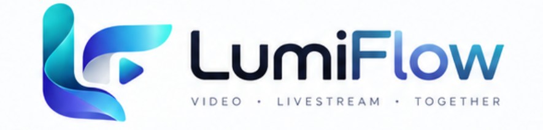
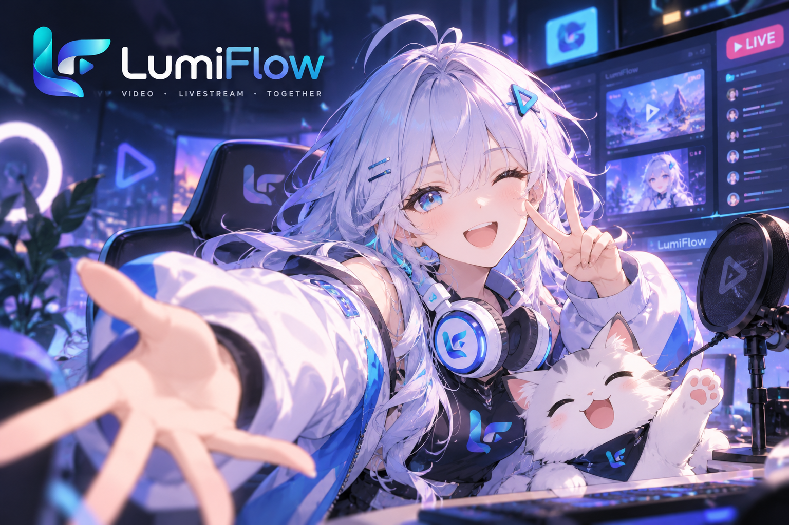
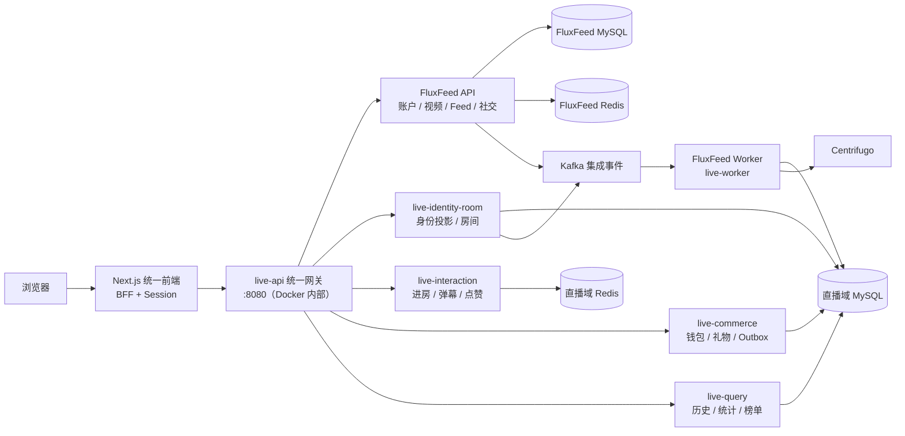
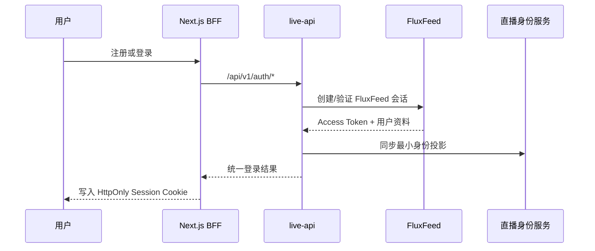

<p align="center">
  
</p>

<p align="center">
  <strong>视频 · 直播 · 社交，一套账号与一个入口</strong>
</p>

<p align="center">
  
  
  
  
  
</p>

# LumiFlow｜视频与直播融合平台

LumiFlow 将 **FluxFeed 短视频系统**与 **LUMI LIVE 直播互动系统**融合为一套产品。用户从统一的 Next.js 前端完成注册登录、浏览视频、发布作品、进入直播大厅和参与互动；后端继续保持清晰的数据所有权，通过统一网关、内部服务与 Kafka 集成事件协作。



<p align="center">
  <a href="#系统能力">系统能力</a> ·
  <a href="#总体架构">总体架构</a> ·
  <a href="#快速启动">快速启动</a> ·
  <a href="#启动后的使用流程">使用流程</a> ·
  <a href="#常用命令">常用命令</a> ·
  <a href="#排障">排障</a>
</p>

> 新系统的主入口只有 `frontend/next-app`。`FluxFeed/apps/web` 与 `live-platform/webui` 作为原系统客户端和调试页面保留，不参与统一前端的正常访问链路。

## 系统能力

| 能力 | 当前状态 | 实际实现 |
| --- | --- | --- |
| 统一登录状态与导航 | ✅ 已接通 | FluxFeed 持有密码/OAuth 会话，网关完成令牌桥接，Next.js BFF 使用 HttpOnly Cookie 保存登录态 |
| 视频 Feed 与视频详情 | ✅ 已接通 | FluxFeed Feed Engine 提供候选、排序、卡片装配和视频详情，统一前端负责展示与点赞 |
| 视频发布与个人作品 | ✅ 已接通 | 资产上传、视频创建、个人作品列表均通过统一网关进入 FluxFeed |
| 直播大厅与房间互动 | ✅ 已接通 | 房间列表、进退房、心跳、弹幕、点赞和历史消息由直播域服务提供 |
| 创作者主页、评论与关注 | ✅ 已接通 | 创作者资料、评论和关注接口均通过统一网关进入 FluxFeed，前端页面已形成完整闭环 |
| 实时广播 | ✅ 已接通 | Next.js 直播页通过 Centrifugo WebSocket 接收弹幕、礼物、统计和个人治理事件，HTTP 保留业务命令与在线心跳职责 |
| 真实视频直播 | 🟡 第二阶段进行中 | SRS 已接通 OBS RTMP、WHEP 低延迟播放、推流鉴权、状态回调及 MP4 录制回放；CDN 与多码率转码待后续接入 |

### 一套身份，两个业务域

注册和登录以 FluxFeed 账户为事实源。统一网关验证 FluxFeed Token，并把直播所需的最小身份投影同步到直播域；直播服务不直接读取 FluxFeed 数据库，视频服务也不接管直播房间数据。

### 视频与直播统一入口

统一前端目前提供以下页面：

| 页面 | 路径 | 用途 |
| --- | --- | --- |
| 品牌首页 | `/` | 矩阵动效产品入口，点击「立即前往」进入应用 |
| 视频首页 | `/discover` | 浏览最新视频 Feed |
| 直播大厅 | `/live` | 浏览正在直播的房间 |
| 发布作品 | `/publish` | 上传视频/封面并创建作品 |
| 个人中心 | `/me` | 查看当前用户作品与关系入口 |
| 关注列表 | `/following` | 查看已关注创作者 |
| 视频详情 | `/videos/{videoId}` | 播放视频、点赞和评论 |
| 创作者主页 | `/users/{userId}` | 查看创作者资料与作品 |
| 直播间 | `/rooms/{roomId}` | 进房、心跳、弹幕和点赞 |

## 总体架构



浏览器只访问 `127.0.0.1:8080`。Next.js 在同源的 `/api/platform/*` BFF 路由中转请求，`live-api:8080`、数据库、缓存、消息队列和观测服务均不映射到宿主机。

### 登录与跨域身份流



### 服务职责

| 组件 | 职责 |
| --- | --- |
| `frontend/next-app` | 唯一产品前端、统一导航、会话 Cookie、平台 BFF |
| `live-api` | 对外 v1 API、鉴权桥接、领域路由，不直接持有业务数据 |
| `fluxfeed-api` | 账户、OAuth、视频资产、Feed、互动、关系和内容治理 |
| `fluxfeed-worker` | 消费视频、互动、曝光与关系事件，更新 Feed 和特征 |
| `live-identity-room` | 直播侧身份投影、房间生命周期与主播治理 |
| `live-interaction` | 进退房、心跳、弹幕、点赞、限流与热点保护 |
| `live-commerce` | 钱包、礼物订单、幂等与 Transactional Outbox |
| `live-query` | 历史消息、房间统计、在线观众和榜单查询 |
| `live-worker` | Outbox、集成事件、归档、投影和实时消息处理 |
| MySQL / Redis / Kafka | 领域持久化、短周期状态和跨服务事件流 |

## 工程目录

```text
LumiFlow/
├── assets/                    # 项目 Logo 等 README 资源
├── frontend/next-app/         # Next.js 统一前端与 BFF
├── FluxFeed/
│   └── apps/api/              # 视频、Feed、账户、关系与治理服务
├── live-platform/             # 直播领域服务、统一网关与融合 Compose
├── docs/                      # 融合方案和内部联调文档
├── Makefile                   # 新系统统一启动入口
└── README.md                  # 当前文档
```

## 快速启动

### 1. 环境要求

首次启动前准备：

- Docker Engine 或 Docker Desktop，且支持 Compose v2
- `curl`
- 推荐至少 8 GB 可用内存和 15 GB 可用磁盘空间

运行系统不需要本机安装 Node.js 或 Go，它们都在容器内构建。只有执行 `make check` 时，才需要本机准备 Node.js 20+、npm 和 Go 1.25+。

可先执行环境检查：

```bash
cd /home/xin/work/LumiFlow
make doctor
```

### 2. 一键启动完整系统

在项目根目录执行：

```bash
make up
```

该命令会依次完成：

1. 校验融合 Compose 配置。
2. 构建 Next.js standalone 镜像以及直播域、FluxFeed API/Worker 镜像。
3. 在同一个 Docker 网络中后台启动全部服务。
4. 等待唯一公开入口就绪。

首次构建和下载 Docker 镜像会花费几分钟。命令完成后访问：

| 服务 | 地址 | 说明 |
| --- | --- | --- |
| LumiFlow 应用入口 | [http://127.0.0.1:8080](http://127.0.0.1:8080) | 页面与同源 BFF 均从这里访问 |
| SRS 媒体端口 | `1935/TCP`、`1985/TCP`、`8000/UDP`、`8085/TCP` | OBS 推流、WHEP、WebRTC 媒体与 MP4 回放 |

`make up` 会在后台运行全部容器。停止系统时执行：

```bash
make down
```

`make down` 会保留 MySQL、Kafka 和 Grafana 等数据卷，下次启动仍可继续使用原数据。

### 3. 确认端口已经收敛

执行：

```bash
cd /home/xin/work/LumiFlow
make ports
```

正常情况下，`lumiflow-web` 显示 `127.0.0.1:8080->3000/tcp`；SRS 还会映射 `1935/TCP`、`1985/TCP`、`8000/UDP` 和 `8085/TCP`，Centrifugo 会在本机映射 `8000/TCP`。其他业务服务和数据库端口只在 Docker 网络内使用。

### 4. 自定义端口

默认唯一入口使用 `8080`。如果本机端口冲突，可覆盖 `WEB_PORT`：

```bash
make up WEB_PORT=4000
```

新端口仍只绑定 `127.0.0.1`。Makefile 会同步更新 FluxFeed OAuth 公共回调地址，不需要手动修改 `.env`。

## 启动后的使用流程

1. 打开 `http://127.0.0.1:8080`，点击「立即前往」进入功能页。
2. 在 `/discover` 浏览视频 Feed；登录或注册后可进入「发布」上传第一个视频。
3. 打开「我的」查看当前账号的作品。
4. 进入「直播」浏览房间；创建房间能力当前由直播 API/调试端提供。
5. 主播在自己的直播间生成 OBS 凭证，使用自定义 RTMP 服务推流，媒体状态变为 `PUBLISHING` 后点击「开始直播」。
6. 观众进入直播间后通过 WHEP 播放视频；点击「进入直播间」即可发送弹幕或点赞，客户端会自动维持在线心跳。

融合 Compose 内置开发管理员：

```text
账号：admin@lumiflow.test
密码：AdminPassword123!
```

该账号和所有 Compose 密钥仅供本地开发，部署前必须替换。

## 常用命令

| 命令 | 作用 |
| --- | --- |
| `make help` | 查看全部统一命令 |
| `make doctor` | 检查本机运行环境 |
| `make up` / `make dev` | 启动完整融合系统 |
| `make services-up` | 构建并后台启动全部融合服务 |
| `make frontend` | 构建并启动容器化统一前端及依赖 |
| `make wait` | 等待唯一公开入口健康 |
| `make ps` | 查看全部融合容器状态 |
| `make ports` | 查看本项目实际映射的宿主机端口 |
| `make health` | 检查公开页面与 Docker 内部网关健康 |
| `make logs` | 跟踪全部容器日志 |
| `make logs S=lumiflow-web` | 只看统一前端日志 |
| `make logs S=live-api` | 只看统一网关日志 |
| `make logs S=fluxfeed-api` | 只看 FluxFeed API 日志 |
| `make check` | 运行两套 Go 测试及前端类型、Lint、构建检查 |
| `make down` | 停止容器并保留数据 |

## 端口与安全边界

- 应用入口只监听 `127.0.0.1:8080`；本地直播体验还会暴露 SRS 的 RTMP、WHEP、WebRTC 和录像端口，以及绑定本机的 Centrifugo WebSocket 端口。
- `live-api:8080`、MySQL、Redis、Kafka、Prometheus、Grafana 等业务与基础设施端口只在 Compose 网络内通信。
- 浏览器调用同源 `/api/platform/*`，Next.js BFF 再通过内部服务名访问网关，浏览器无需知道任何后端端口。
- 前端容器使用非 root 用户运行，并移除 Linux capabilities、启用 `no-new-privileges`。
- 若确实需要远程访问，应在入口前配置 TLS 反向代理、认证、访问控制与防火墙，不要直接改成 `0.0.0.0` 暴露开发环境。

## 排障

### Docker 无法启动

```bash
make doctor
docker info
```

如果提示端口占用，先执行 `make down`，或用 `WEB_PORT` 换端口。

### 前端显示“服务暂不可用”

```bash
curl http://127.0.0.1:8080
make health
make ps
make logs S=lumiflow-web
make logs S=live-api
make logs S=fluxfeed-api
```

确认从项目根目录执行 `make up`；容器会自动注入内部网关地址 `http://live-api:8080`。

### 首次启动长时间未就绪

MySQL 初始化、Kafka Topic 创建和 Go 镜像构建都可能拉长首次启动时间。先通过 `make ps` 查看健康状态，再检查对应服务日志。不要在初始化过程中反复删除数据卷。

### OAuth 回调地址不匹配

本地融合模式默认公共地址为 `http://127.0.0.1:8080`。若修改入口端口，应始终通过同一条命令启动：

```bash
make up WEB_PORT=4000
```

第三方 OAuth 还需要配置对应 Provider 的 Client ID、Client Secret 和回调地址；未配置时普通账号密码登录不受影响。

## 进一步阅读

- [直播平台与 FluxFeed 微服务融合方案](docs/直播平台与FluxFeed微服务融合方案.md)
- [内部 gRPC 联调与性能优化方案](docs/内部gRPC联调与性能优化方案.md)
- [LUMI LIVE 详细说明](live-platform/README.md)
- [FluxFeed 详细说明](FluxFeed/README.md)
- [统一前端说明](frontend/next-app/README.md)

## 项目边界

当前仓库重点验证统一身份、短视频内容、直播互动、SRS 单码率低延迟直播、本地 MP4 录制回放和事件驱动集成。生产级多码率转码/CDN、对象存储与录像生命周期管理、内容审核模型、真实支付结算和多地域容灾仍需要在部署前补齐，并重新执行安全、容量与故障验证。
